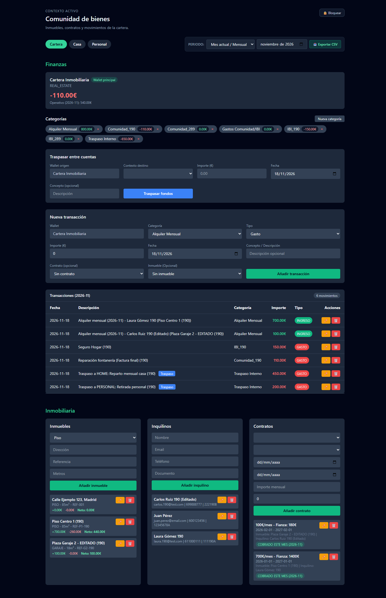
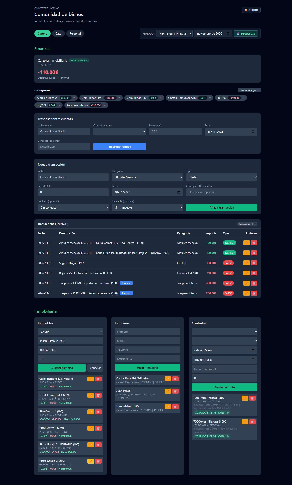
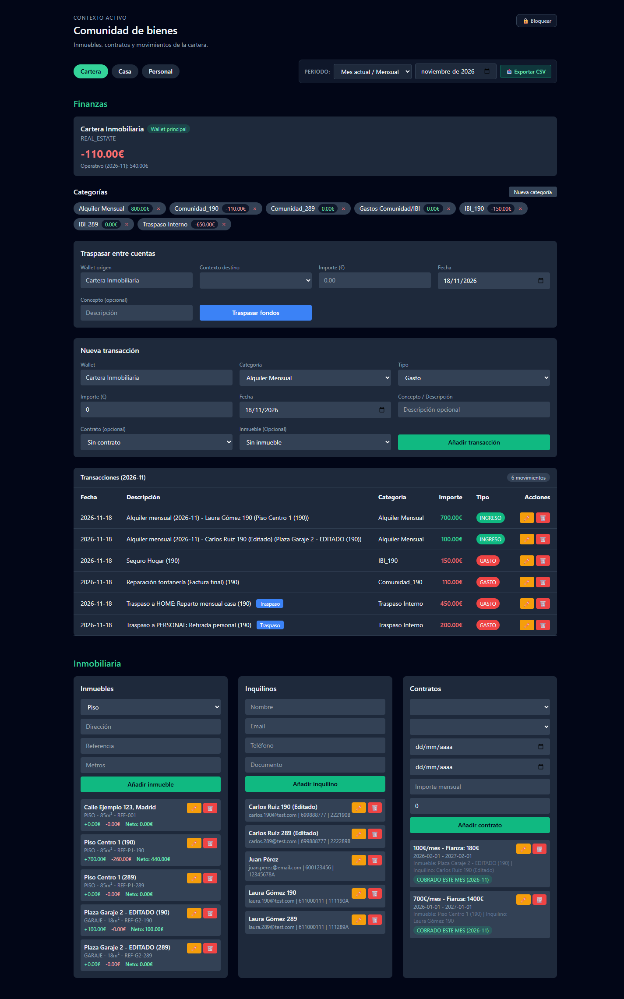
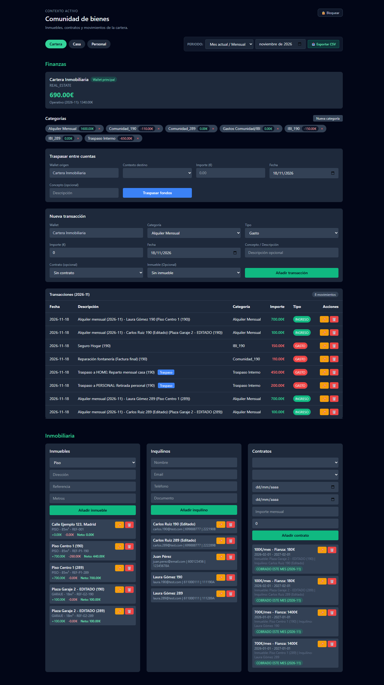
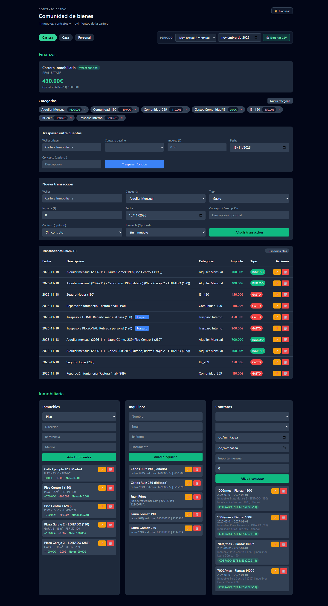
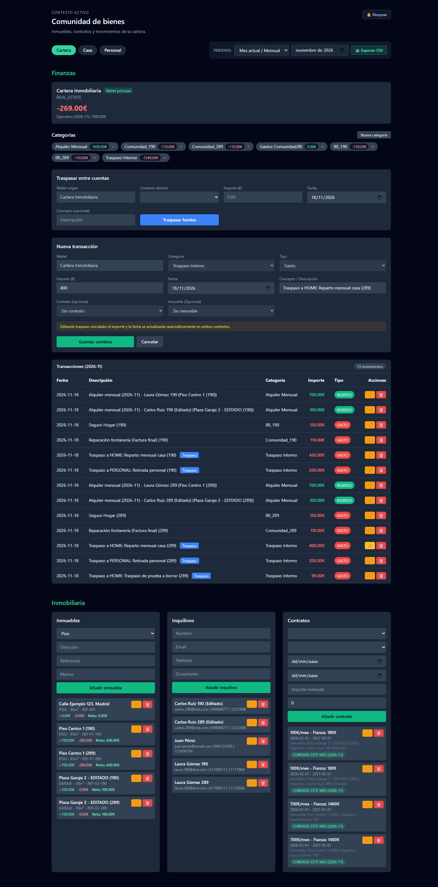
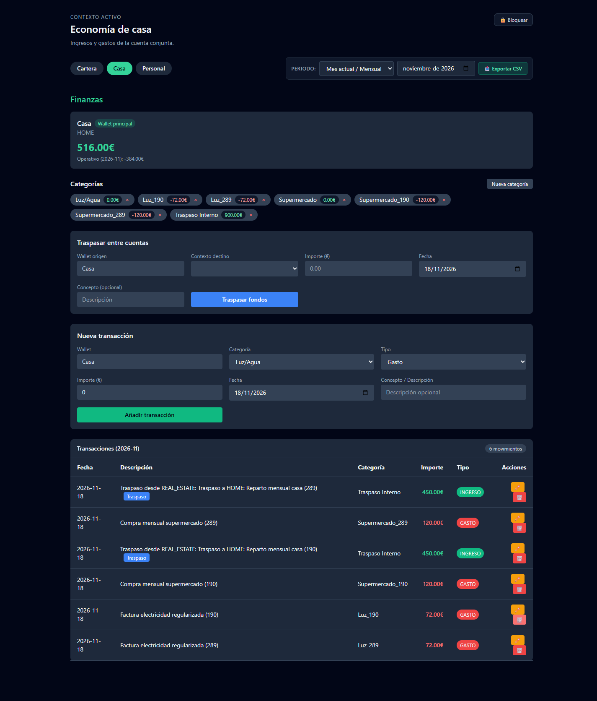
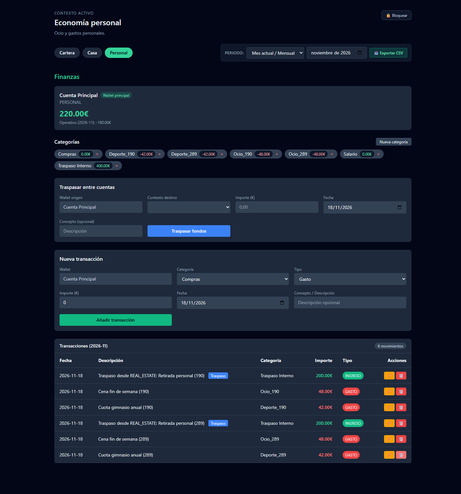

# Manual de Usuario Visual — Gestión de Alquileres Multi-Contexto

> **Documento validado automáticamente mediante pruebas E2E reales (`scripts/test_completo_app.py`)**.
> Todas las capturas de pantalla corresponden a la ejecución en vivo contra **Angular 18 + Spring Boot 3 + PostgreSQL** bajo el patrón de prueba **«Crear 3 → Editar 1 → Borrar 1»**.

---

## 1. Arquitectura de los 3 Contextos y Filtro Temporal Global

La aplicación separa de forma estricta tres ámbitos contables mediante la cabecera `X-Context-Id` y claves foráneas compuestas en base de datos:

| Pestaña UI | Contexto (`X-Context-Id`) | Wallet Principal Única | Propósito Contable |
| :--- | :--- | :--- | :--- |
| **Cartera** | `REAL_ESTATE` | `Cartera Inmobiliaria` | Gestión de patrimonio inmobiliario: pisos, garajes, locales, inquilinos, contratos y flujo de caja de alquileres. |
| **Casa** | `HOME` | `Casa` | Economía doméstica compartida: suministros, supermercado y mantenimiento del hogar. |
| **Personal** | `PERSONAL` | `Cuenta Principal` | Finanzas individuales: salario, ocio, deporte y gastos personales. |

### Selector de Periodo Temporal Global y Reglas Contables
En la barra superior derecha dispones del **Filtro de Periodo Temporal** con tres modos (**Mes actual / Mensual**, **Anual** para cierres fiscales IRPF / Modelo 184, y **Todo el histórico**):
- **Saldo Real en Caja (No filtrado):** Muestra siempre el dinero real acumulado disponible en la cuenta bancaria.
- **Resultado Operativo del Periodo (Filtrado):** Calcula el beneficio o gasto neto del mes/año seleccionado excluyendo los `Traspasos Internos` entre tus propias cuentas.
- **Píldoras de Categorías, Tabla de Transacciones y Rentabilidad de Inmuebles (Filtrados):** Se recalibran al instante al cambiar de mes o año.

---

## 2. Wallet Principal y Categorías con Totales Acumulados

En cada contexto existe **una única Wallet Principal** protegida para evitar fragmentar saldos. Justo debajo se gestionan las **Categorías** del contexto:
1. Pulsa **Nueva categoría**, introduce el nombre y haz clic en **Crear**.
2. Cada píldora muestra en tiempo real su **total acumulado en `€`** en el periodo activo (en verde si es positivo, en rojo si es gasto neto).
3. Pulsa **`×`** para eliminar una categoría sin movimientos (si tiene transacciones asociadas, el backend protege la integridad devolviendo `409 Conflict`).

---

## 3. Gestión de Inmuebles e Inquilinos (Alta, Edición y Borrado)

### 3.1 Inmuebles y Modo Edición (`PUT`)
- **Alta:** Selecciona el tipo (`Piso`, `Chalet`, `Local`, `Garaje`), dirección, referencia catastral/interna y superficie en m², y pulsa **Añadir inmueble**.
- **Edición (`✏️`):** Al pulsar el icono de lápiz sobre cualquier inmueble, el formulario carga sus datos y el botón cambia a **Guardar cambios** (con opción de **Cancelar**).
- **Borrado (`🗑️`):** Elimina el inmueble tras confirmación (protegido con `409 Conflict` si tiene contratos o transacciones vinculados).

### 3.2 Inquilinos con Control de Documento Único
- Registra nombre completo, email, teléfono y DNI/NIE/Pasaporte (único por contexto).
- Permite edición directa con **`✏️`** y borrado protegido con **`🗑️`**.

---

## 4. Contratos de Alquiler y Cobro Mensual en 1 Clic

En la columna **Contratos** vinculas un **Inmueble** con un **Inquilino**, definiendo fechas de vigencia, **Importe mensual** y **Fianza**:
- **Estado de Cobro Automático:** Cada tarjeta de contrato evalúa el mes seleccionado en el filtro superior:
  - 🟠 **`PENDIENTE DE COBRO (YYYY-MM)`**: Aún no se ha registrado el ingreso del alquiler en ese mes. Muestra el botón rápido **«Cobrar mes (+X €)»**.
  - 🟢 **`COBRADO ESTE MES (YYYY-MM)`**: Ya consta abonada la mensualidad del periodo.
- **Acción «Cobrar mes» en 1 clic:** Genera automáticamente la transacción de `INGRESO` por el importe mensual del contrato en la wallet principal, imputada a la categoría *Alquiler Mensual*, al contrato y al inmueble correspondiente.

---

## 5. Transacciones y Rentabilidad Neta por Inmueble

El formulario **Nueva transacción** registra ingresos y gastos asignándolos automáticamente a la wallet principal del contexto:
- En **Cartera (`REAL_ESTATE`)** puedes vincular opcionalmente un **Contrato** (autocompleta inmueble e importe) o un **Inmueble** concreto (ej. *Seguro Hogar*, *Reparación fontanería*, *IBI*).
- Cada tarjeta de **Inmueble** calcula en vivo su cuenta de explotación del periodo seleccionado:
  - **`+Ingresos €`** (verde) · **`-Gastos €`** (rojo) · **`Neto: €`** (rentabilidad neta del activo).
- Todas las filas de la tabla cuentan con edición inline (**`✏️`**) y eliminación (**`🗑️`**).

---

## 6. Traspasos entre Cuentas con Edición y Borrado en Espejo

El bloque **Traspasar entre cuentas** mueve liquidez entre contextos (por ejemplo, repartir beneficios desde `Cartera` hacia `Casa` o `Personal`):
1. Genera atómicamente dos apuntes gemelos enlazados por `traspaso_par_id` bajo la categoría **`Traspaso Interno`**: un `GASTO` en la cuenta origen y un `INGRESO` en la cuenta destino.
2. **Edición en Espejo (`✏️`):** Al editar una transacción de traspaso, se muestra un aviso ámbar bloqueando categoría, tipo y vínculos inmobiliarios, y al guardar se actualiza el **importe, fecha y descripción simultáneamente en ambos contextos**.
3. **Borrado en Espejo (`🗑️`):** Al eliminar un traspaso desde cualquiera de los dos contextos, se elimina automáticamente su transacción gemela en el otro contexto para mantener el cuadre contable.

---

## 7. Operativa en Contextos «Casa» (`HOME`) y «Personal» (`PERSONAL`)

### 7.1 Pestaña Casa (`HOME`)
- Recibe automáticamente como `INGRESO` los traspasos enviados desde `Cartera` (incluyendo cualquier edición o borrado en espejo).
- Permite gestionar categorías domésticas (*Supermercado*, *Luz*, etc.) y registrar, editar o eliminar gastos del hogar.

### 7.2 Pestaña Personal (`PERSONAL`)
- Aísla los movimientos particulares y de ocio sobre la wallet `Cuenta Principal`, reflejando también los traspasos recibidos.

---

## 8. Resumen de Pruebas E2E Ejecutadas (`Crear 3 -> Editar 1 -> Borrar 1`)

- **Lote de ejecución:** Sufijo `289` · **Fecha:** `18/11/2026 13:10`

| Bloque | Caso de Prueba Verificado | Estado | Detalle |
| :--- | :--- | :---: | :--- |
| **Seguridad PIN** | Desbloqueo con PIN maestro (1234 -> X-App-Pin) | ✅ OK | Sesión desbloqueada |
| **Bloque 1** | Verificar Wallet única principal en Cartera | ✅ OK | Cartera Inmobiliaria |
| **Bloque 1** | Crear 3 categorías en Cartera | ✅ OK | IBI_289, Comunidad_289, Basuras_289 |
| **Bloque 1** | Borrar 1 categoría sin transacciones (×) | ✅ OK | Eliminada Basuras_289 |
| **Bloque 2** | Crear 3 Inmuebles (Piso, Garaje, Local) | ✅ OK | Piso Centro 1 (289), Plaza Garaje 2 (289), Local Comercial 3 (289) |
| **Bloque 2** | Editar Inmueble #2 (PUT) | ✅ OK | Plaza Garaje 2 - EDITADO (289) (18 m²) |
| **Bloque 2** | Borrar Inmueble #3 (DELETE) | ✅ OK | Eliminado Local Comercial 3 (289) |
| **Bloque 3** | Crear 3 Inquilinos con documentos únicos | ✅ OK | 111289A, 222289B, 333289C |
| **Bloque 3** | Editar Inquilino #2 (PUT) | ✅ OK | Carlos Ruiz 289 (Editado) | Tel: 699888777 |
| **Bloque 3** | Borrar Inquilino #3 (DELETE) | ✅ OK | Eliminado Marta Díaz 289 |
| **Bloque 4** | Crear 3 Contratos vinculados | ✅ OK | 700€, 90€ y 450€ |
| **Bloque 4** | Editar Contrato #2 (90€ -> 100€/mes) | ✅ OK | Actualizado a 100€/mes |
| **Bloque 4** | Borrar Contrato #3 temporal (DELETE) | ✅ OK | Eliminado contrato de 450€ |
| **Bloque 4** | Cobrar mes en 1 clic sobre Contrato #1 (+700€) | ✅ OK | Badge -> COBRADO ESTE MES |
| **Bloque 4** | Cobrar mes en 1 clic sobre Contrato #2 (+100€) | ✅ OK | Badge -> COBRADO ESTE MES |
| **Bloque 5** | Crear 3 Transacciones de gasto imputadas a Inmueble #1 | ✅ OK | 150€, 80€, 45€ |
| **Bloque 5** | Editar Transacción #2 (80€ -> 110€) | ✅ OK | Reparación fontanería (Factura final) (289) |
| **Bloque 5** | Borrar Transacción #3 errónea (45€) | ✅ OK | Eliminada Gasto erróneo a borrar (289) |
| **Bloque 5** | Verificar Rentabilidad Neta por Inmueble y Totales por Categoría | ✅ OK | Inmueble #1 Neto: 440.00€ | Inmueble #2 Neto: 100.00€ |
| **Bloque 5** | Verificar Selector de Periodo (Mensual/Anual/Histórico) y Saldo Real fijo | ✅ OK | Saldo Real fijo (430.00€) | Operativo, tabla y contratos recalibrados en 2026-10 |
| **Bloque 6** | Crear 3 Traspasos entre contextos (Cartera -> Casa/Personal) | ✅ OK | 400€, 200€, 99€ |
| **Bloque 6** | Editar en espejo Traspaso #1 (400€ -> 450€) | ✅ OK | Sincronizado en Cartera y Casa |
| **Bloque 6** | Borrar en espejo Traspaso #3 (99€) | ✅ OK | Eliminado en origen y destino |
| **Bloque 7** | Verificar en Casa sincronización en espejo (+450€ y ausencia de 99€) | ✅ OK | Cuadre contable verificado |
| **Bloque 7** | Crear 3 gastos domésticos en Casa | ✅ OK | 120€, 65€, 30€ |
| **Bloque 7** | Editar gasto doméstico en Casa (65€ -> 72€) | ✅ OK | Factura electricidad regularizada (289) |
| **Bloque 7** | Borrar gasto doméstico duplicado en Casa (30€) | ✅ OK | Eliminado Gasto doméstico duplicado (289) |
| **Bloque 7** | Verificar en Personal recepción de Traspaso #2 (+200€) | ✅ OK | Retirada personal (289) |
| **Bloque 7** | Crear 3 movimientos en Personal | ✅ OK | 48€, 35€, 15€ |
| **Bloque 7** | Editar movimiento en Personal (35€ -> 42€) | ✅ OK | Cuota gimnasio anual (289) |
| **Bloque 7** | Borrar movimiento en Personal (15€) | ✅ OK | Eliminado Suscripción cancelada (289) |

---
*Manual y evidencias generados automáticamente el 18/11/2026 13:10 mediante `python scripts/test_completo_app.py`.*