# Manual de Usuario Visual — Gestión de Alquileres Multi-Contexto

> **Guía Oficial de Operativa Diaria, Control Patrimonial y Cierre Fiscal**
> Validado al 100% mediante la suite de certificación E2E (`scripts/test_completo_app.py`) sobre **Angular 18 + Spring Boot 3.5 + PostgreSQL 17**.
> Incluye el catálogo completo de **15 capturas reales paso a paso** en `docs/screenshots/`.

---

## 1. Acceso, Seguridad con Clave Maestra y Auto-BCrypt

Toda la información financiera y patrimonial está protegida por una capa de seguridad perimetral respaldada en PostgreSQL (`tabla configuracion_seguridad`) y validada en cada petición mediante la cabecera `X-App-Pin`.

### 1.1 Pantalla de Desbloqueo Inicial
Al abrir la aplicación, se presenta la pantalla de bloqueo centrada:
- Introduce tu clave maestra (por defecto `1234`) en el campo **«Introduce la clave de acceso»** y pulsa **Desbloquear**.

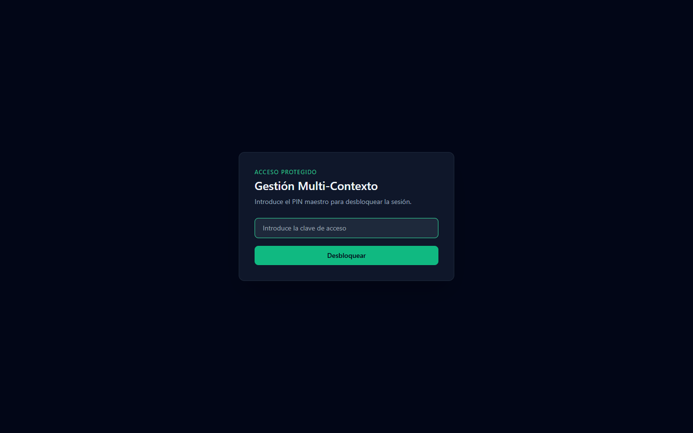

### 1.2 Protección contra Accesos No Autorizados y Fuerza Bruta
- Si introduces una clave incorrecta, el servidor responde `401 Unauthorized` y se muestra inmediatamente el aviso en rojo **«PIN de acceso inválido o ausente»**.
- Si una misma dirección IP acumula **5 intentos fallidos seguidos**, el sistema bloquea automáticamente esa IP durante **15 minutos** (`429 Too Many Requests`).

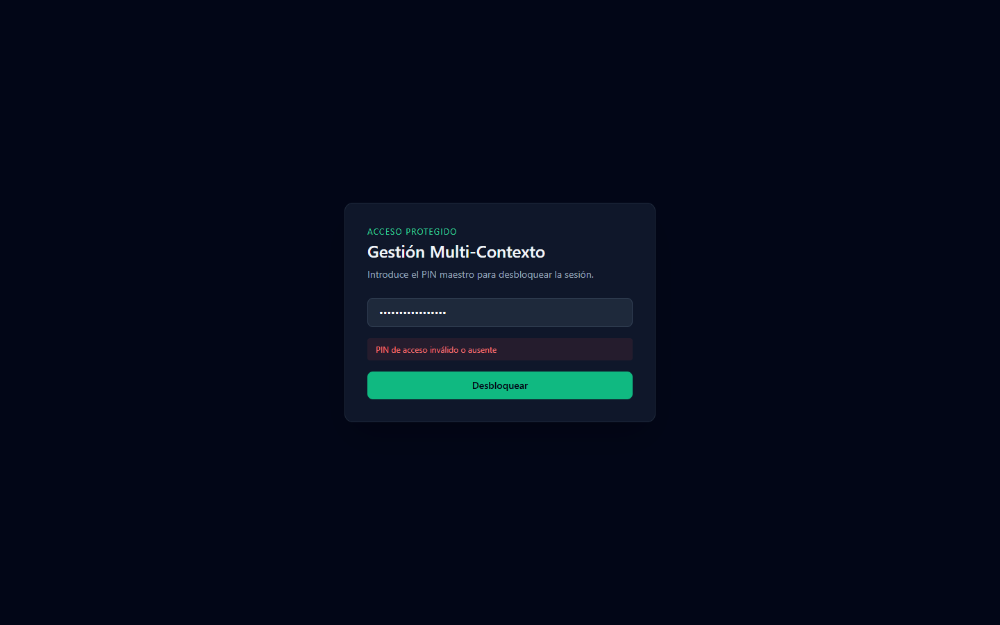

### 1.3 Cambio de Contraseña («🔑 Cambiar clave») y Cierre de Sesión («🔒 Bloquear»)
En la esquina superior derecha dispones de dos controles de seguridad:
1. **`🔑 Cambiar clave`**: Despliega el formulario para introducir tu **Clave actual** y la **Nueva clave** (mínimo 4 caracteres). Al pulsar **Guardar clave**, se cifra en **BCrypt (`$2a$10$...`)** en base de datos y se actualiza tu sesión sin desconectarte.
2. **`🔒 Bloquear`**: Borra la clave de la memoria del navegador (`localStorage`) y bloquea la pantalla al instante.
3. **Recuperación o cambio directo desde SQL (Auto-BCrypt):** Si editas la tabla `configuracion_seguridad` directamente en PostgreSQL escribiendo una contraseña en texto plano (`UPDATE configuracion_seguridad SET valor = 'MiClave' WHERE clave = 'APP_PASSWORD'`), el backend la detecta en caliente sin reiniciar y la convierte automáticamente a BCrypt en cuanto inicies sesión con ella.

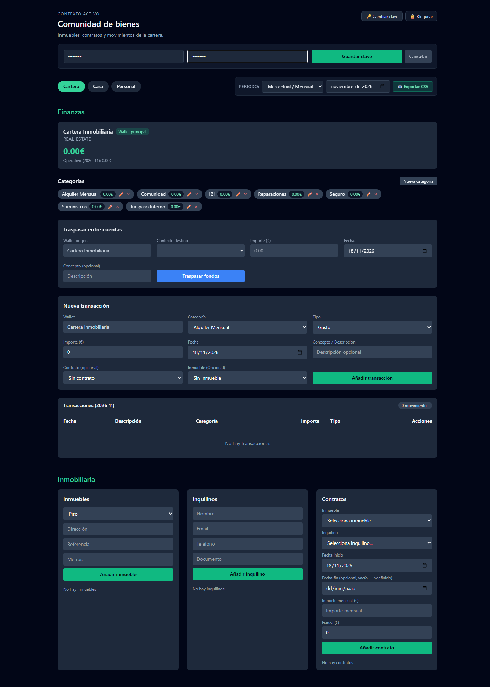

---

## 2. Los 3 Contextos Contables y Vista General de «Cartera»

La aplicación divide tus finanzas en **tres contextos aislados** que jamás mezclan sus datos:

| Pestaña | Contexto (`X-Context-Id`) | Wallet Principal Única | Propósito |
| :--- | :--- | :--- | :--- |
| **Cartera** | `REAL_ESTATE` | `Cartera Inmobiliaria` | Gestión de inmuebles, inquilinos, contratos de alquiler, cobros mensuales y rentabilidad por propiedad. |
| **Casa** | `HOME` | `Casa` | Economía familiar/doméstica: supermercado, suministros, seguros y gastos del hogar. |
| **Personal** | `PERSONAL` | `Cuenta Principal` | Economía individual: nómina/ingresos, ocio, deporte y compras personales. |

Cada contexto cuenta con **una única Wallet Principal** protegida, mostrando dos indicadores clave:
- **Saldo Real en Caja (cifra grande):** Es el dinero real disponible hoy en la cuenta bancaria, calculado en PostgreSQL sobre todo el histórico (incluyendo traspasos).
- **Resultado Operativo (`Operativo (...)`):** Es el beneficio o gasto limpio del periodo seleccionado en el filtro superior, **excluyendo los traspasos internos** entre tus propias cuentas.

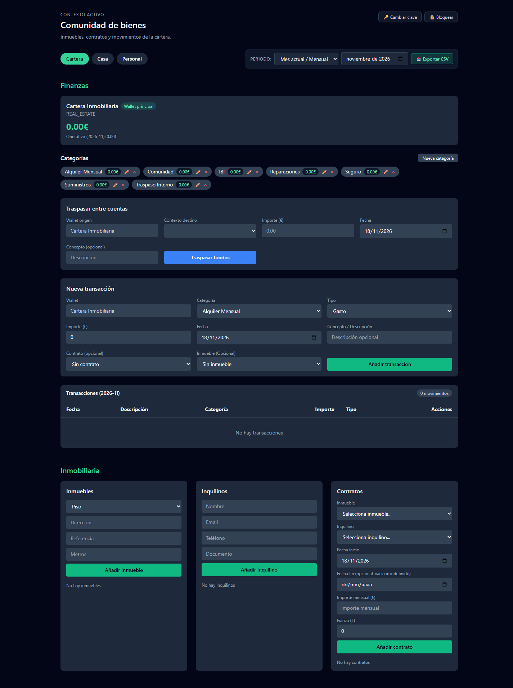

---

## 3. Gestión de Categorías y Totales por Partida (`€`)

Debajo de la tarjeta de la Wallet Principal se encuentra el panel de **Categorías** del contexto activo:
1. Pulsa **Nueva categoría**, escribe el nombre y haz clic en **Crear**.
2. Cada categoría se muestra como una píldora con su **importe acumulado en `€`** durante el periodo seleccionado (en verde si es positivo, en rojo si es gasto neto).
3. Pulsa **`✏️`** en cualquier píldora para renombrar la categoría (`PUT`) o **`×`** para eliminarla si no tiene movimientos asociados.

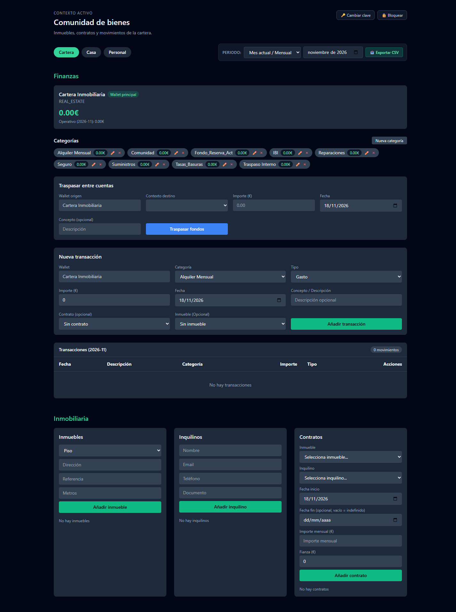

---

## 4. Módulo Inmobiliario: Inmuebles e Inquilinos (`Crear`, `Editar ✏️`, `Borrar 🗑️`)

Exclusivo de la pestaña **Cartera (`REAL_ESTATE`)**, permite administrar todo tu parque inmobiliario:

### 4.1 Inmuebles
- **Alta:** Selecciona el tipo (`Piso`, `Chalet`, `Local`, `Garaje`), indica la **Dirección**, **Referencia** y **Metros**, y pulsa **Añadir inmueble**.
- **Edición (`✏️`):** Carga los datos del inmueble en el formulario superior y cambia el botón a **Guardar cambios** (junto con **Cancelar**).
- **Rentabilidad en vivo:** Cada ficha muestra sus ingresos (`+€`), gastos (`-€`) y **Neto (`€`)** en el periodo seleccionado.

### 4.2 Inquilinos
- **Alta y Edición (`✏️`):** Registra **Nombre**, **Email**, **Teléfono** y **Documento** (DNI/NIE/Pasaporte).
- **Control de DNI Único (`409 Conflict`):** Si intentas registrar dos inquilinos con el mismo documento en el mismo contexto, el sistema bloquea el duplicado y muestra una alerta en pantalla.

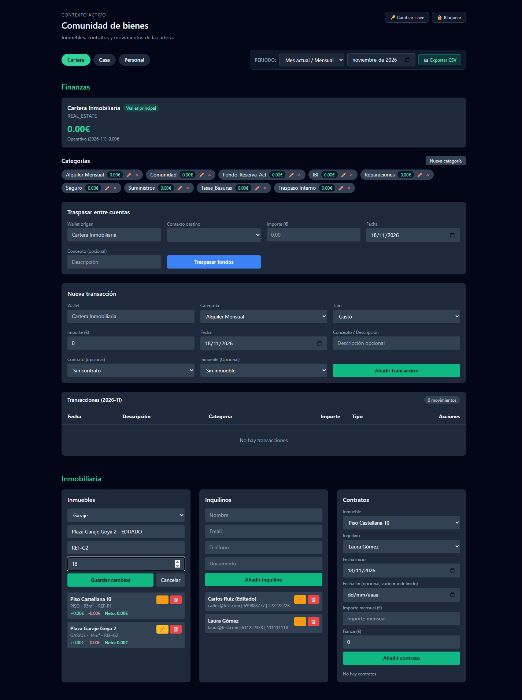

---

## 5. Contratos de Alquiler, Validaciones y Cobro Mensual en 1 Clic

### 5.1 Validaciones Inteligentes en el Formulario de Contratos
Al crear o editar un contrato en la tercera columna:
- Si solo existe `1` inmueble o `1` inquilino registrado, el desplegable lo preselecciona automáticamente.
- El sistema valida que se hayan elegido un inmueble e inquilino válidos (`> 0`), que la **Fecha de fin** (opcional; vacío = indefinido) no sea anterior a la **Fecha de inicio**, y que no se duplique un contrato idéntico (`409 Conflict`), mostrando cualquier error en un banner rojo dentro del propio formulario:

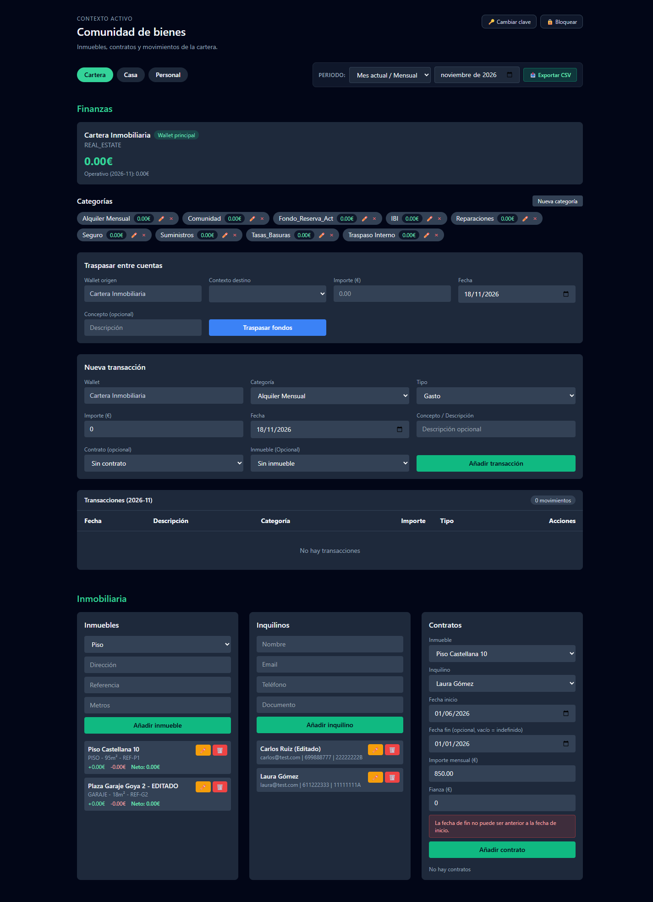

### 5.2 Estados Dinámicos del Contrato y Botón «Cobrar mes (+X €)»
Cada contrato evalúa automáticamente sus fechas de vigencia frente al mes seleccionado en el filtro superior (`filtroMes`):
- 🟢 **`COBRADO ESTE MES (YYYY-MM)`**: Ya existe un ingreso de alquiler vinculado a este contrato en el mes consultado.
- 🟠 **`PENDIENTE DE COBRO (YYYY-MM)`**: El contrato está vigente en el mes consultado y aún no se ha cobrado. Muestra el botón **«Cobrar mes (+X €)»**.
- ⚪ **`CONTRATO FINALIZADO`**: El mes consultado es posterior a la `fechaFin` del contrato (oculta el botón de cobro).
- ⚪ **`AÚN NO INICIADO (YYYY-MM)`**: El mes consultado es anterior a la `fechaInicio` del contrato (oculta el botón de cobro).

Al pulsar **«Cobrar mes (+X €)»**, se registra en 1 solo clic el `INGRESO` en la wallet principal con la categoría *Alquiler Mensual*, imputado al contrato y al inmueble correspondiente:

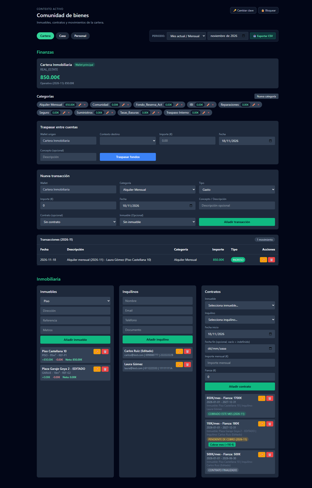

---

## 6. Transacciones e Imputación de Rentabilidad Neta por Inmueble

En el formulario **Nueva transacción** puedes registrar cualquier movimiento manual:
- En **Cartera**, al seleccionar un **Contrato** se autocompletan el **Inmueble** y el **Importe**. También puedes imputar gastos directamente a un **Inmueble** (*IBI*, *Comunidad*, *Seguro*, *Reparaciones*).
- Cada fila de la tabla **Transacciones** cuenta con botones para **Editar (`✏️`)** y **Eliminar (`🗑️`)**, actualizando al instante el **Saldo Real en Caja**, las **Categorías** y el **Neto de cada Inmueble**:

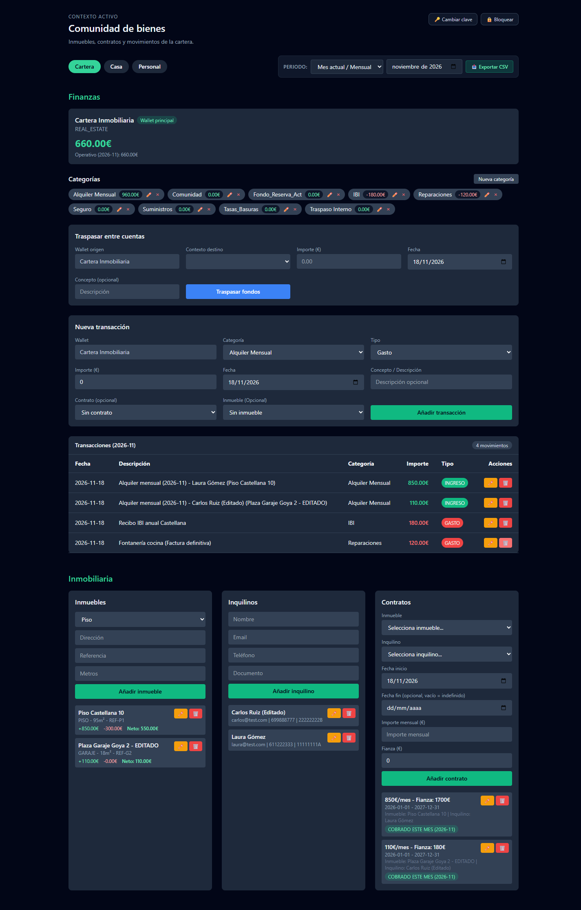

---

## 7. Traspasos entre Cuentas con Edición y Borrado en Espejo

El formulario **Traspasar entre cuentas** transfiere dinero entre contextos (por ejemplo, desde `Cartera` hacia `Casa` o `Personal`):
- Crea atómicamente dos transacciones vinculadas por `traspaso_par_id` bajo la categoría **`Traspaso Interno`**: un `GASTO` en la cuenta origen y un `INGRESO` en la cuenta destino.
- **Edición en Espejo (`✏️`):** Al editar un traspaso en la tabla, aparece el aviso ámbar *«Editando traspaso vinculado: el importe y la fecha se actualizarán automáticamente en ambos contextos»* y se bloquean los selectores estructurales. Al guardar, ambas cuentas se actualizan a la vez.
- **Borrado en Espejo (`🗑️`):** Al borrar un traspaso desde cualquier contexto, se elimina también su transacción gemela en el otro contexto.

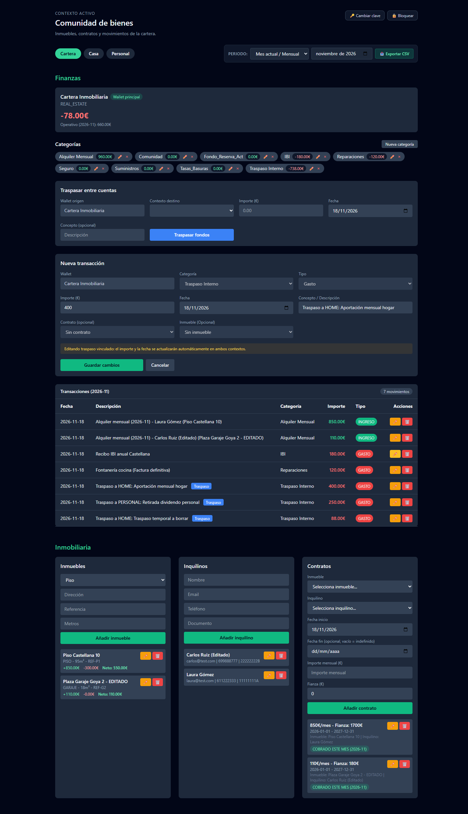

---

## 8. Filtro Temporal Global (`Mensual` / `Anual` / `Histórico`) y Exportación CSV

### 8.1 Filtrado SQL por Periodo manteniendo el Saldo Real en Caja Fijo
Al cambiar el selector superior entre **Mes actual / Mensual**, **Anual** (para cierres fiscales de IRPF) o **Todo el histórico**:
- El **Saldo Real en Caja** de la Wallet permanece fijo reflejando tu saldo bancario real (`-40.00€` tras los traspasos en el ejemplo).
- El **Resultado Operativo (`+660.00€`)**, las **Píldoras de Categorías**, la **Tabla** y la **Rentabilidad por Inmueble** se recalibran en PostgreSQL para el periodo elegido:

### 8.2 Descarga de Informe para Excel / Hacienda («📥 Exportar CSV»)
Al pulsar **«📥 Exportar CSV»**, se descarga un archivo `.csv` con codificación **UTF-8 con BOM (`\uFEFF`)**, separador `;`, celdas entrecomilladas blindadas contra *CSV Injection* y un bloque final con el **Resumen de Rentabilidad por Inmueble** del periodo seleccionado:

---

## 9. Operativa en «Casa» (`HOME`) y «Personal» (`PERSONAL`)

### 9.1 Pestaña Casa (`HOME`)
Muestra la wallet principal **`Casa`**, refleja automáticamente los ingresos recibidos por traspaso desde `Cartera` (sincronizados en espejo) y permite gestionar todos los gastos domésticos (*Supermercado*, *Suministros*, *Seguro*, *Ocio*):

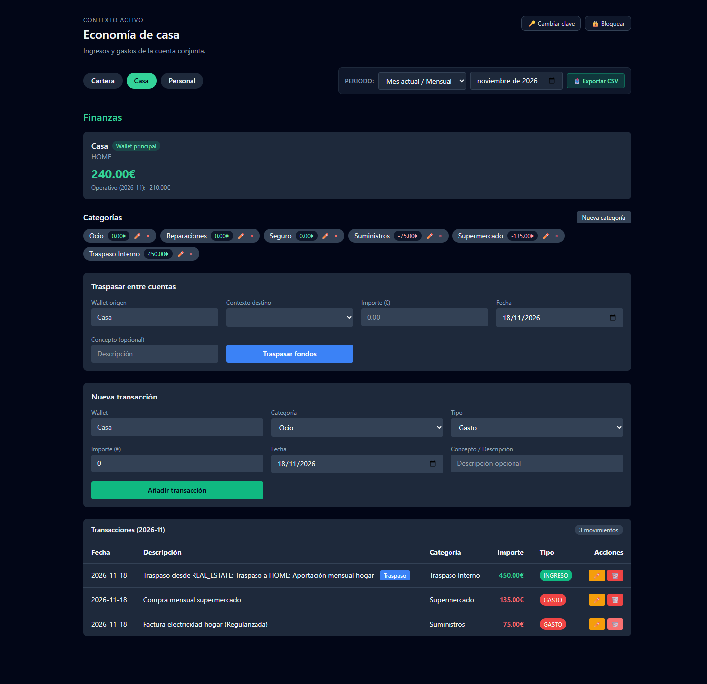

### 9.2 Pestaña Personal (`PERSONAL`)
Muestra la wallet principal **`Cuenta Principal`**, refleja los traspasos recibidos y gestiona tus ingresos (*Nómina / Ingresos*) y gastos particulares con total independencia:

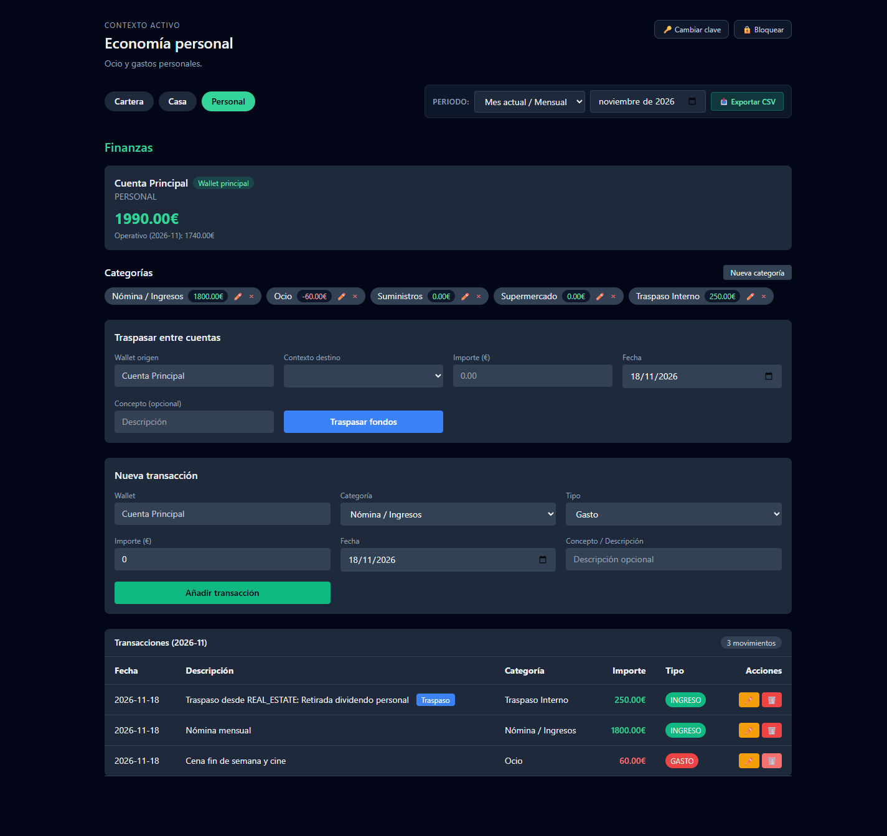

---

## 10. Protección de Integridad Referencial (`409 Conflict`)

El sistema protege tu histórico contable a nivel de base de datos PostgreSQL y de aplicación:
- Si intentas eliminar una **Categoría**, **Inmueble**, **Inquilino** o **Contrato** que tenga contratos o transacciones vinculados, el servidor impide el borrado (`409 Conflict`) y muestra un banner de advertencia explicando la causa en la parte superior de la pantalla:

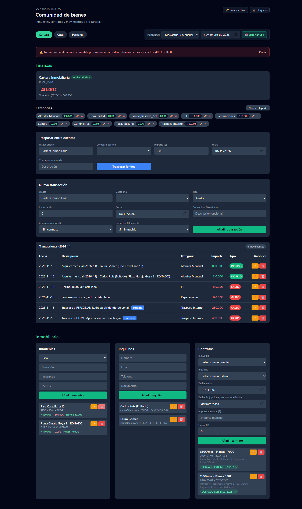
