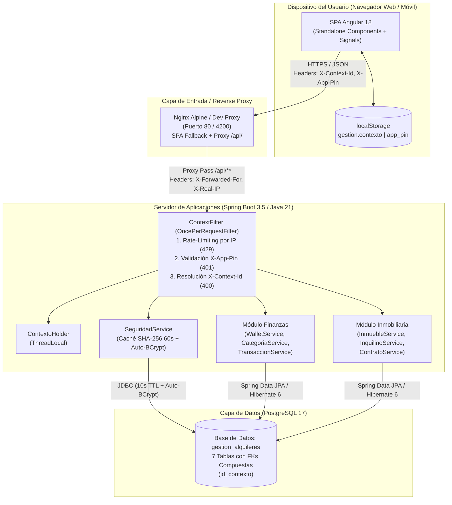
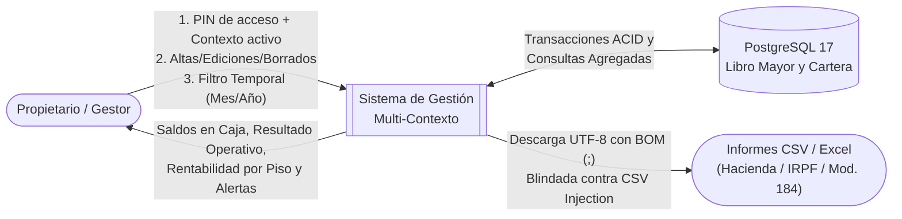
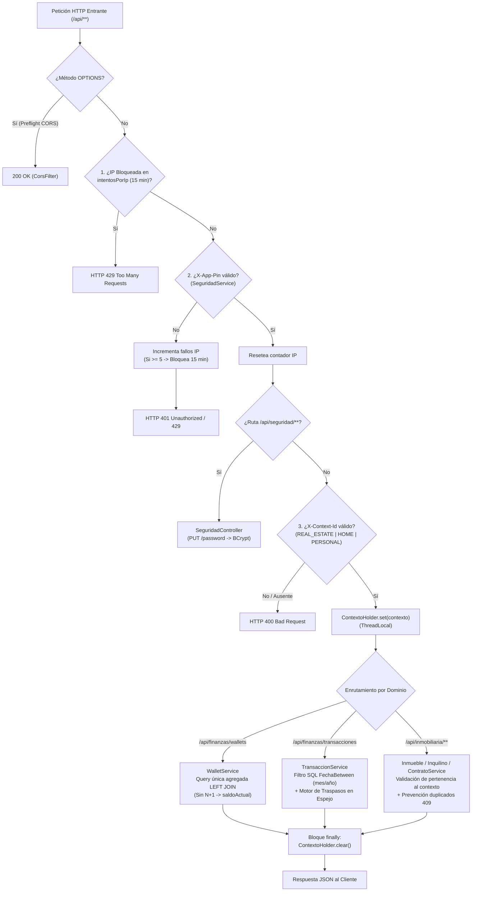
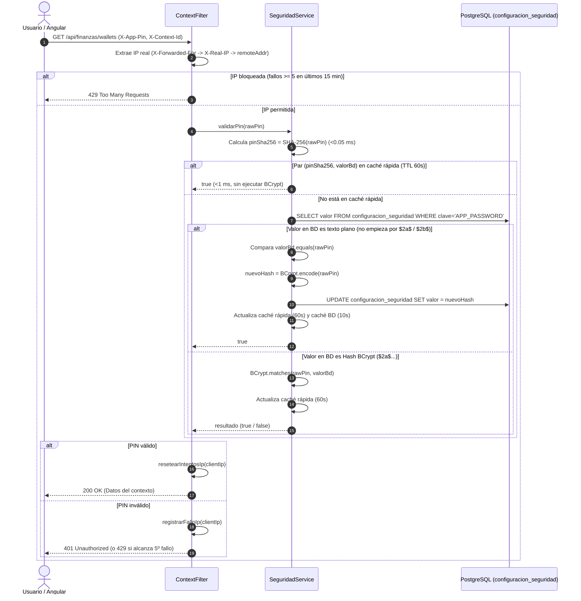
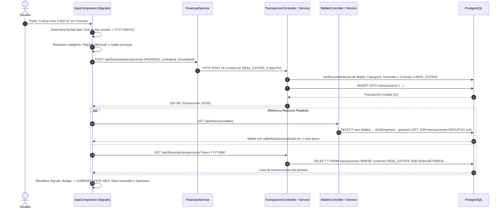
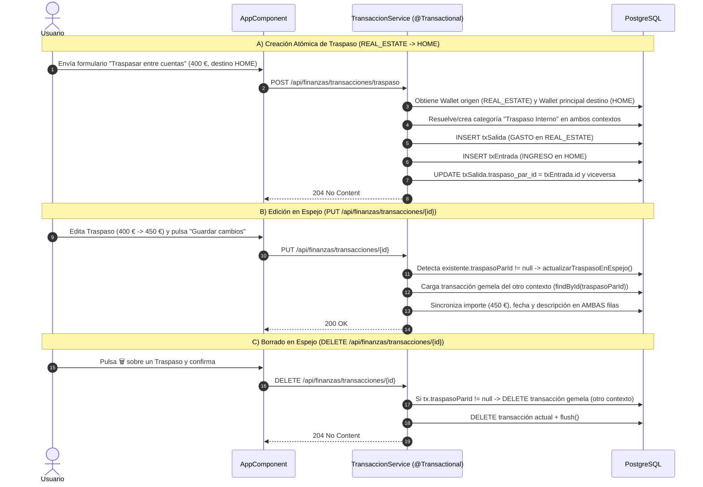

# Arquitectura del Sistema y Diagramas de Flujo de Datos (DDF)

> **Proyecto:** Sistema de Gestión de Alquileres y Finanzas Multi-Contexto (`gestion_alquileres_app`)
> **Stack:** Angular 18.2 (Signals + Standalone) · Spring Boot 3.5.16 (Java 21) · PostgreSQL 17.4 · Docker / Nginx

---

## 1. Visión Arquitectónica y Modelo C4 (Contexto y Contenedores)

El sistema implementa una arquitectura **Multi-Tenant Lógico por Contexto (`REAL_ESTATE`, `HOME`, `PERSONAL`)** sobre una única instancia de base de datos relacional (**Shared Database, Shared Schema** con aislamiento físico garantizado mediante **Claves Foráneas Compuestas `(id, contexto)`**).

### 1.1 Diagrama de Contenedores (C4 Nivel 2)

---

## 2. Diagramas de Flujo de Datos (DDF)

### 2.1 DDF Nivel 0 (Diagrama de Contexto)

### 2.2 DDF Nivel 1 (Flujo Detallado de Procesamiento Interno)

---

## 3. Diagramas de Secuencia UML de Flujos Críticos

### 3.1 Autenticación Perimetral, Rate-Limiting, Caché SHA-256 y Auto-BCrypt Híbrido

### 3.2 Cobro Mensual de Contrato en 1 Clic y Recálculo Reactivo de Saldos

### 3.3 Creación, Edición (`PUT`) y Borrado (`DELETE`) en Espejo de Traspasos entre Contextos

