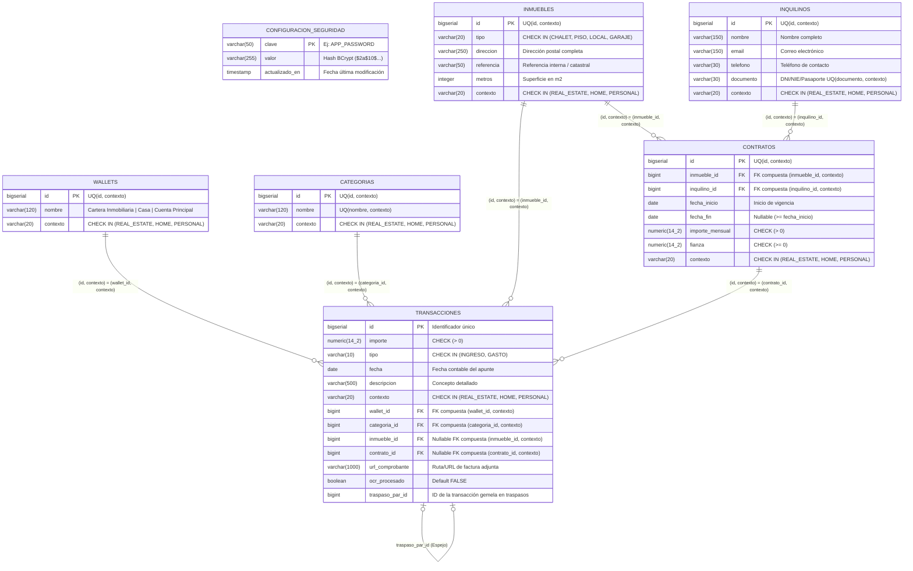

# Esquema de Base de Datos y Diccionario SQL (`PostgreSQL 17`)

> **Proyecto:** Sistema de Gestión de Alquileres Multi-Contexto (`gestion_alquileres_app`)
> **Motor:** PostgreSQL 17 (`schema.sql`, `data.sql`, `scripts/reset_produccion.sql`)

---

## 1. Diagrama Entidad-Relación (ERD) Completo

---

## 2. Arquitectura de Claves Foráneas Compuestas `(id, contexto)`

El requisito arquitectónico más importante del modelo de datos es impedir físicamente que un registro de un contexto (ej. `PERSONAL`) pueda referenciar entidades de otro contexto (ej. un `inmueble` de `REAL_ESTATE` o una `categoria` de `HOME`), incluso ante un hipotético fallo en la capa de aplicación.

Para lograrlo:
1. Todas las tablas maestras (`wallets`, `categorias`, `inmuebles`, `inquilinos`, `contratos`) declaran un índice único compuesto `UNIQUE (id, contexto)`.
2. Las tablas dependientes (`contratos` y `transacciones`) declaran sus `FOREIGN KEY` incluyendo **siempre** la columna `contexto`:
   - `FOREIGN KEY (wallet_id, contexto) REFERENCES wallets (id, contexto)`
   - `FOREIGN KEY (categoria_id, contexto) REFERENCES categorias (id, contexto)`
   - `FOREIGN KEY (inmueble_id, contexto) REFERENCES inmuebles (id, contexto)`
   - `FOREIGN KEY (contrato_id, contexto) REFERENCES contratos (id, contexto)`
3. Todas las relaciones aplican por defecto la regla `ON DELETE RESTRICT` (`NO ACTION` en PostgreSQL), lo que garantiza que jamás se pueda borrar por accidente una `wallet`, `categoria`, `inmueble`, `inquilino` o `contrato` que posea historial contable asociado (capturado por Spring Boot mediante `repository.flush()` y devuelto como `409 Conflict`).

---

## 3. Diccionario Detallado de Tablas

### 3.1 `configuracion_seguridad`
Almacena parámetros críticos de seguridad del sistema (como la contraseña maestra en formato BCrypt).

| Columna | Tipo SQL | Nulo | Por Defecto | Restricciones / Descripción |
| :--- | :--- | :---: | :---: | :--- |
| `clave` | `VARCHAR(50)` | `NO` | — | `PRIMARY KEY` (ej. `'APP_PASSWORD'`). |
| `valor` | `VARCHAR(255)` | `NO` | — | Hash BCrypt (`$2a$10$...`) o texto plano temporal que se auto-hashea en el primer uso. |
| `actualizado_en` | `TIMESTAMP` | `SÍ` | `CURRENT_TIMESTAMP` | Marca temporal de la última actualización de clave. |

### 3.2 `wallets`
Cuentas principales donde se agrupan los movimientos de cada contexto.

| Columna | Tipo SQL | Nulo | Restricciones / Índices |
| :--- | :--- | :---: | :--- |
| `id` | `BIGSERIAL` | `NO` | `PRIMARY KEY`, `uq_wallets_id_contexto UNIQUE (id, contexto)`. |
| `nombre` | `VARCHAR(120)` | `NO` | Nombre oficial (`Cartera Inmobiliaria`, `Casa`, `Cuenta Principal`). |
| `contexto` | `VARCHAR(20)` | `NO` | `CHECK (contexto IN ('REAL_ESTATE', 'HOME', 'PERSONAL'))`, `idx_wallets_contexto`. |

### 3.3 `categorias`
Partidas presupuestarias y fiscales independientes por contexto.

| Columna | Tipo SQL | Nulo | Restricciones / Índices |
| :--- | :--- | :---: | :--- |
| `id` | `BIGSERIAL` | `NO` | `PRIMARY KEY`, `uq_categorias_id_contexto UNIQUE (id, contexto)`. |
| `nombre` | `VARCHAR(120)` | `NO` | `uq_categorias_nombre_contexto UNIQUE (nombre, contexto)`. |
| `contexto` | `VARCHAR(20)` | `NO` | `CHECK (contexto IN ('REAL_ESTATE', 'HOME', 'PERSONAL'))`, `idx_categorias_contexto`. |

### 3.4 `inmuebles`
Activos inmobiliarios gestionados en el contexto `REAL_ESTATE`.

| Columna | Tipo SQL | Nulo | Restricciones / Índices |
| :--- | :--- | :---: | :--- |
| `id` | `BIGSERIAL` | `NO` | `PRIMARY KEY`, `uq_inmuebles_id_contexto UNIQUE (id, contexto)`. |
| `tipo` | `VARCHAR(20)` | `NO` | `CHECK (tipo IN ('CHALET', 'PISO', 'LOCAL', 'GARAJE'))`. |
| `direccion` | `VARCHAR(250)` | `NO` | Dirección física del inmueble. |
| `referencia` | `VARCHAR(50)` | `SÍ` | Referencia interna o catastral. |
| `metros` | `INTEGER` | `SÍ` | Superficie construida/útil en m². |
| `contexto` | `VARCHAR(20)` | `NO` | `CHECK (contexto IN ('REAL_ESTATE', 'HOME', 'PERSONAL'))`, `idx_inmuebles_contexto`. |

### 3.5 `inquilinos`
Arrendatarios registrados en la cartera inmobiliaria.

| Columna | Tipo SQL | Nulo | Restricciones / Índices |
| :--- | :--- | :---: | :--- |
| `id` | `BIGSERIAL` | `NO` | `PRIMARY KEY`, `uq_inquilinos_id_contexto UNIQUE (id, contexto)`. |
| `nombre` | `VARCHAR(150)` | `NO` | Nombre y apellidos o razón social. |
| `email` | `VARCHAR(150)` | `SÍ` | Correo electrónico de contacto. |
| `telefono` | `VARCHAR(30)` | `SÍ` | Teléfono móvil/fijo. |
| `documento` | `VARCHAR(30)` | `SÍ` | `uq_inquilinos_documento_contexto UNIQUE (documento, contexto)`, índice parcial `WHERE documento IS NOT NULL`. |
| `contexto` | `VARCHAR(20)` | `NO` | `CHECK (contexto IN ('REAL_ESTATE', 'HOME', 'PERSONAL'))`, `idx_inquilinos_contexto`. |

### 3.6 `contratos`
Contratos de arrendamiento que vinculan un inmueble y un inquilino del mismo contexto.

| Columna | Tipo SQL | Nulo | Restricciones / Índices |
| :--- | :--- | :---: | :--- |
| `id` | `BIGSERIAL` | `NO` | `PRIMARY KEY`, `uq_contratos_id_contexto UNIQUE (id, contexto)`. |
| `inmueble_id` | `BIGINT` | `NO` | `fk_contratos_inmueble FOREIGN KEY (inmueble_id, contexto) REFERENCES inmuebles (id, contexto)`. |
| `inquilino_id` | `BIGINT` | `NO` | `fk_contratos_inquilino FOREIGN KEY (inquilino_id, contexto) REFERENCES inquilinos (id, contexto)`. |
| `fecha_inicio` | `DATE` | `NO` | Fecha de entrada en vigor. |
| `fecha_fin` | `DATE` | `SÍ` | `ck_contratos_fechas CHECK (fecha_fin IS NULL OR fecha_fin >= fecha_inicio)`. |
| `importe_mensual` | `NUMERIC(14,2)` | `NO` | `CHECK (importe_mensual > 0)`. |
| `fianza` | `NUMERIC(14,2)` | `NO` | `DEFAULT 0 CHECK (fianza >= 0)`. |
| `contexto` | `VARCHAR(20)` | `NO` | `CHECK (contexto IN ('REAL_ESTATE', 'HOME', 'PERSONAL'))`, `idx_contratos_contexto`. |

### 3.7 `transacciones`
Libro mayor unificado de ingresos, gastos y traspasos internos.

| Columna | Tipo SQL | Nulo | Restricciones / Índices |
| :--- | :--- | :---: | :--- |
| `id` | `BIGSERIAL` | `NO` | `PRIMARY KEY`. |
| `importe` | `NUMERIC(14,2)` | `NO` | `CHECK (importe > 0)`. |
| `tipo` | `VARCHAR(10)` | `NO` | `CHECK (tipo IN ('INGRESO', 'GASTO'))`. |
| `fecha` | `DATE` | `NO` | Índice compuesto `idx_transacciones_wallet_fecha (wallet_id, fecha)`. |
| `descripcion` | `VARCHAR(500)` | `SÍ` | Concepto descriptivo del movimiento. |
| `contexto` | `VARCHAR(20)` | `NO` | `CHECK (contexto IN ('REAL_ESTATE', 'HOME', 'PERSONAL'))`, `idx_transacciones_contexto`. |
| `wallet_id` | `BIGINT` | `NO` | `fk_transacciones_wallet FOREIGN KEY (wallet_id, contexto) REFERENCES wallets (id, contexto)`. |
| `categoria_id` | `BIGINT` | `NO` | `fk_transacciones_categoria FOREIGN KEY (categoria_id, contexto) REFERENCES categorias (id, contexto)`. |
| `inmueble_id` | `BIGINT` | `SÍ` | `fk_transacciones_inmueble FOREIGN KEY (inmueble_id, contexto) REFERENCES inmuebles (id, contexto)`. |
| `contrato_id` | `BIGINT` | `SÍ` | `fk_transacciones_contrato FOREIGN KEY (contrato_id, contexto) REFERENCES contratos (id, contexto)`. |
| `url_comprobante` | `VARCHAR(1000)` | `SÍ` | URL/path del justificante documental. |
| `ocr_procesado` | `BOOLEAN` | `NO` | `DEFAULT FALSE`. |
| `traspaso_par_id` | `BIGINT` | `SÍ` | Puntero bidireccional al ID de la transacción espejo en traspasos entre contextos. |
